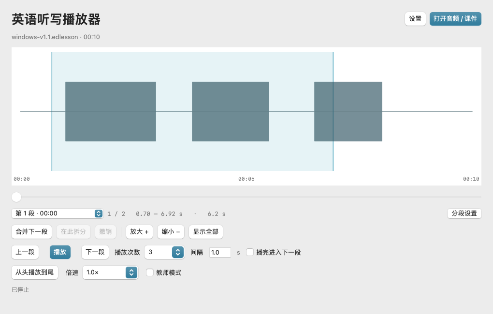
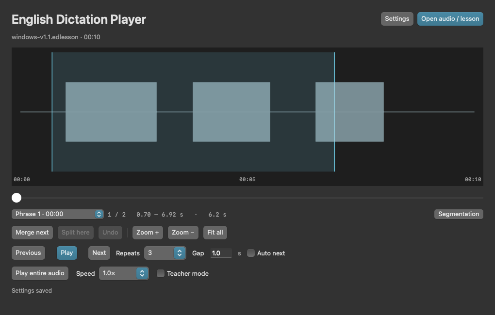

# 英语听写播放器 Mac 版 1.1

作者 **ThermoXu**，免费使用。使用原生 SwiftUI 与 AVFoundation，支持 **macOS 13 Ventura 及以上**，同一个 Universal 应用包含 Apple Silicon 与 Intel 两种架构，无需 Rosetta、Python、Node 或联网。

## 运行

推荐打开 `EnglishDictationPlayer-Mac-Universal.dmg`，将 `English Dictation Player.app` 拖到“Applications / 应用程序”，然后从应用程序中打开。也可解压 `EnglishDictationPlayer-Mac-Universal.zip` 后复制应用。

本次构建为 ad-hoc 本地签名，没有 Apple Developer ID 签名和公证。macOS 可能提示无法验证开发者。请只在确认下载来源后按系统提供的“右键 → 打开”或“系统设置 → 隐私与安全性 → 仍要打开”确认；不需要关闭 Gatekeeper 或修改系统安全策略。单位管理的 Mac 可能禁止运行未公证应用，此时需要管理员批准或后续提供 Developer ID 公证版。

## 与 Windows 原型对应的功能

- 按停顿自动分段、最短 / 最长区间、三种分组推荐、短词合并、句首预留。
- 波形单击选段、拖动手动选区、双指捏合及按钮缩放、时间滑块。
- 开始、暂停、继续、重复次数、重复间隔、自动下一段、下一段立即播放可选开关。
- 0.5 / 0.8 / 1.0 / 1.2 / 1.5 / 2.0 倍速，AVAudioUnitTimePitch 保持音调。
- 从头播放到尾、合并下一段、光标拆分、20 步撤销、可选 ±0.1 秒边界微调、按时长自动留白。
- 教师模式：保存包含音频和分段的 `.edlesson` 课件，重新打开不自动重分段。
- 默认 / 黑色模式、中文 / English、作者与帮助、设置保存。

分段按声音能量和停顿判断，不识别句子语法。分析按块读取音频，不把整段 PCM 载入内存；波形只绘制当前视野，并按屏幕像素合并峰值。

## 音频与课件兼容

常用 MP3、WAV、M4A、AAC、FLAC 由系统解码；也可打开 AIFF / CAF。**WMA 不保证支持，请先转换为 MP3 或 WAV。**

支持 Windows v1.1 保存的 `.edlesson`，保留精确时间点、当前片段或手动选区。使用 MP3 / WAV / M4A 等共同格式的 Mac 课件，也能在 Windows v1.1 打开；AIFF / CAF 课件仅 Mac 支持。课件不是通用音频文件，学生也需此播放器。单个音频最大 2 GB。

教师模式下编辑后点击“保存课件”，课件可移动或分享，无需另外附音频。没有自动保存；关闭或换文件前提示未保存的编辑。播放设置保存在各自电脑，不被课件覆盖。

## 快捷键

空格：播放 / 暂停 / 继续；← / →：切换片段；Return：片段从头播放；Esc：停止；⌘O：打开；⌘S：保存课件；⌘,：设置；F1：帮助。输入框内保留常规编辑按键。

## 构建与验证

在 Mac 上运行 `bash macOS/build.sh`，使用 Xcode Command Line Tools 自带 Swift 编译器同时构建 arm64、x86_64，合并为 Universal 应用，添加图标与 ad-hoc 签名，输出 ZIP。没有第三方依赖。

运行 `"macOS/dist/English Dictation Player.app/Contents/MacOS/DictationPlayer" --self-test` 执行分段、配置、课件及六档倍速原生离线渲染测试。设置 `WINDOWS_LESSON=macOS/fixtures/windows-v1.1.edlesson` 可同时验证 Windows 课件导入。GitHub Actions 在 Apple Silicon 和 Intel 两种 macOS 环境验证，17 项回归及 9 项原生窗口检查均通过。最终测试结果及限制见 [TEST_REPORT.md](TEST_REPORT.md)。

## 界面预览

